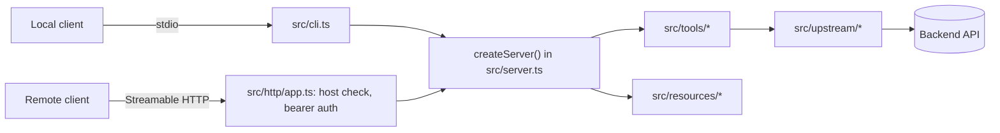

# Architecture

| Path | Does |
|---|---|
| `src/cli.ts` | Starts stdio by default, or HTTP with `--http` |
| `src/server.ts` | Builds a fresh `McpServer` per connection or request, with every tool and resource |
| `src/tools/` | One file per tool: schemas, annotations, and the handler |
| `src/resources/` | Resources and their data |
| `src/http/` | The Hono app: health, protected resource metadata, auth, and the MCP handler |
| `src/auth/` | Token and JWT verifiers |
| `src/upstream/` | Clients for backend APIs, with timeouts and response validation |

## Key behaviors

- **Both protocol eras:** clients on the stateless 2026-07-28 protocol and clients on the older `initialize` handshake are both served, over stdio and HTTP.
- **Stateless HTTP:** every request gets a new server instance, so it scales horizontally with no session store.
- **Safe defaults:** HTTP binds to localhost, checks the `Host` header against DNS rebinding, and won't start until you pick an auth mode.
- **Clean stdout:** logs go to stderr, so they never corrupt stdio messages.
