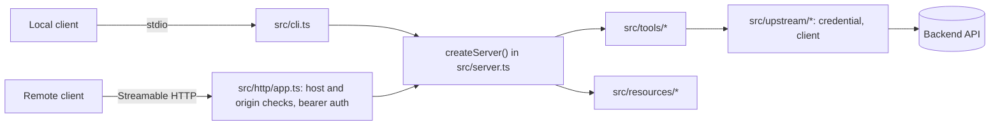

# Architecture

| Path | Does |
|---|---|
| `src/cli.ts` | Starts stdio by default, or HTTP with `--http` |
| `src/server.ts` | Builds a fresh `McpServer` per connection or request, with every enabled tool and resource |
| `src/tools/` | One file per tool, defined with `defineTool`: scope, schemas, annotations, and the handler |
| `src/tools/index.ts` | The tool list. Enabled tools and `scopes_supported` come from it |
| `src/tools/tool.ts` | `defineTool`: registers a tool with its scope challenge, a span and metrics per call, and error handling that turns `UpstreamError` into `isError` results and logs anything else with an error ID |
| `src/resources/` | Resources and their data |
| `src/http/` | The Hono app: health, protected resource metadata, auth, and the MCP handler |
| `src/auth/` | Token and JWT verifiers |
| `src/upstream/` | Clients for backend APIs, with timeouts and response validation, and the credential each call sends |
| `src/telemetry.ts` | Starts OpenTelemetry, only when `OTEL_EXPORTER_OTLP_ENDPOINT` is set |

## Key behaviors

- **Both protocol eras:** clients on the stateless 2026-07-28 protocol and clients on the older `initialize` handshake are both served, over stdio and HTTP.
- **Stateless HTTP:** every request gets a new server instance, so it scales horizontally with no session store.
- **Safe defaults:** HTTP binds to localhost, checks the `Host` and `Origin` headers, requires `https://` for OAuth outside localhost, and won't start until you pick an auth mode.
- **Request logs:** every HTTP response, including auth and host-check rejections, carries an `X-Request-Id`, and an `info` log line records its ID, method, path, status, duration, and the client ID once authenticated. Tokens are never logged.
- **Graceful shutdown:** on `SIGTERM` or `SIGINT`, HTTP mode fails `/readyz`, waits `SHUTDOWN_DRAIN_SECONDS` while still serving, then stops accepting connections. Requests in flight get up to `SHUTDOWN_TIMEOUT_SECONDS` to finish, so a slow tool call still returns its result. Only then does it end open `subscriptions/listen` streams and close the rest.
- **Health:** `/healthz` is liveness. `/readyz` is readiness, and fails while starting or draining. Neither calls the upstream.
- **Telemetry:** with `OTEL_EXPORTER_OTLP_ENDPOINT` set, HTTP requests and tool calls get spans and metrics, upstream calls send `traceparent`, and log lines carry `trace_id` and `span_id`. Without it, nothing is loaded.
- **Clean stdout:** logs go to stderr, so they never corrupt stdio messages.
